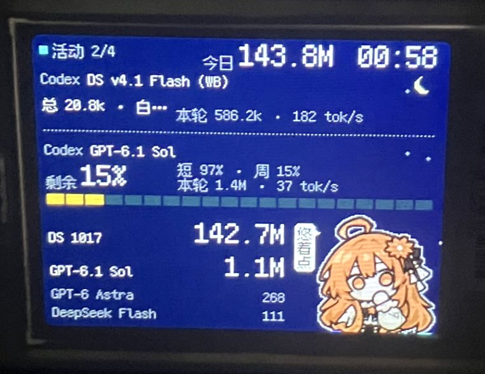
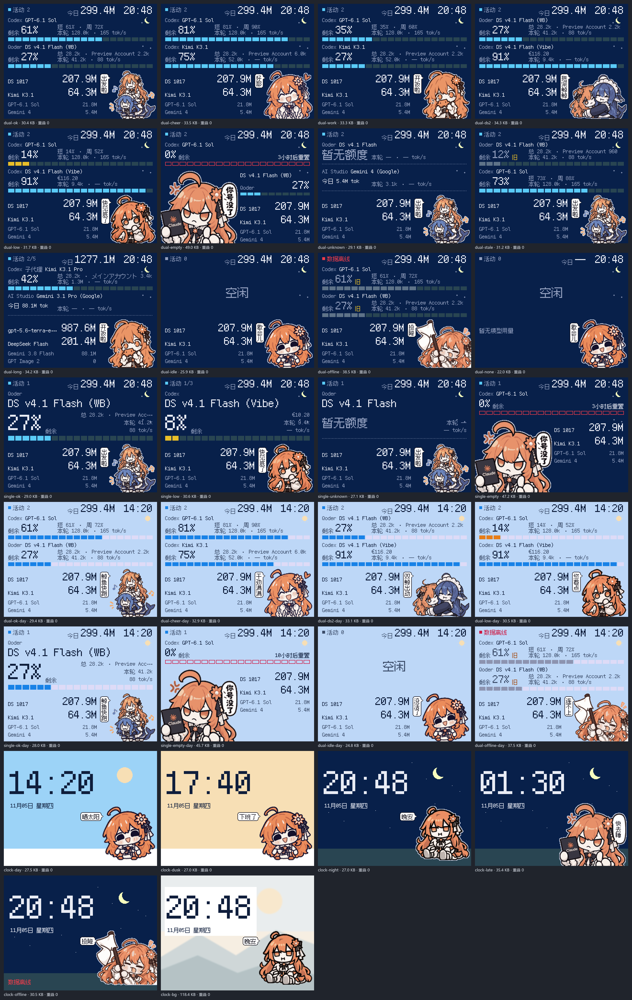
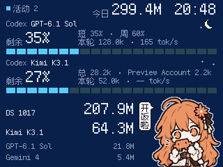
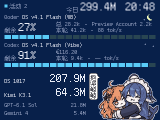
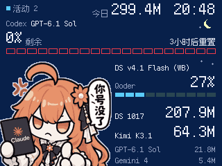
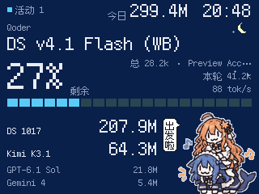
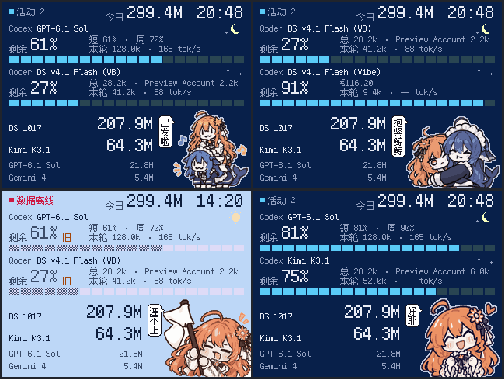

# AI LCD · 桌面 AI 额度屏

一个面向 **320×240 横屏蓝牙 LCD** 的通用 AI 用量看板实例。它把 Codex、Qoder、各类账号管理器或反向代理的本地数据，整理成实体的活动模型、今日用量、配额和速度画面。

## 作者与协作

产品、使用场景、实体硬件验证与设计方向：**白ゆき**

代码实现与工程验证：**DeepSeek**

交互与像素界面设计、状态板、素材映射与视觉审查：**Claude**

这是一个展示和适配说明仓库，运行版源码位于独立项目。它不是对任何账号管理器、反代或模型服务的官方集成。

## 为什么不把某家反代写死

每个人可能使用 Magpie、sub2api、WorkBuddy、Qoder、AI Studio 或自己维护的反代。它们的数据结构、端口和账号字段各不相同。

因此分工是：

| 部分 | 职责 |
| --- | --- |
| 屏幕核心 | 320×240 页面、像素字、额度条、状态人物、自动切页、BLE 传输 |
| 数据适配器 | 用户自己拥有并把本地数据整理为统一快照 |
| 可选管理器 | Magpie、sub2api 等各自管理账号、余额和请求记录 |

**只接入用户实际拥有的来源。** 没有安装的软件不需要制造“未接入”条目；适配器只需输出存在的客户端、请求和额度。

## 页面状态

下图是 Claude 通过 Pillow 实际渲染的状态板，数据为示意：

- 双模型活动，DeepSeek 与非 DeepSeek 同时工作时显示小克和鲸鱼娘；
- 双 DeepSeek 或单独 DeepSeek 时仍只显示小克；
- 0%、低于 20%、离线、旧快照、未知额度使用不同人物和提示；
- 夜间的月球、星星与浅色描边保证人物可辨；
- 今日榜仅显示实际接入的主任务模型。

| 双卡工作 | 双 DeepSeek | 额度耗尽 |
| --- | --- | --- |
|  |  |  |

| 夜间时钟 | 单卡大字 | 三倍放大细节 |
| --- | --- | --- |
|  |  |  |

## 本机参考实例（示意，不是通用默认值）

本机曾经使用如下组件；其他用户可按自己的实际软件替换。

| 组件 | 地址 / 角色 | 开源或说明 |
| --- | --- | --- |
| Codex / 本地 harness | 本机调用 | [openai/codex](https://github.com/openai/codex) |
| OpenCodex 类聚合入口 | 参考端口 `10100` | [clidge-jun/opencodex](https://github.com/clidge-jun/opencodex)；需核对本机实际版本，不是同一部署的保证 |
| WorkBuddy 反代 | 参考端口 `8788` | [ardeyouxipianyi/workbuddy2api-hub](https://github.com/ardeyouxipianyi/workbuddy2api-hub)（MIT）；账号和余额字段按你的版本适配 |
| Mistral Vibe 反代 | 参考端口 `8800` | [mistralai/mistral-vibe](https://github.com/mistralai/mistral-vibe) 是 CLI；本机所用兼容反代没有在本仓库认定为某个固定上游 |
| AI Studio 2 API | 参考端口 `2048` | [Mag1cFall/AIStudio2API](https://github.com/Mag1cFall/AIStudio2API)（MIT）；`requests.db` 结构可随版本变化 |
| 聚合看板 | 参考端口 `8801` | 本项目的本地适配实例；不是第三方依赖，也不是 GitHub 上的独立服务 |

示例 `config.reference.json` 只展示屏幕需要的配置形状。账号别名、套餐总额、池 ID 和设备地址必须由部署者自行填写；它们不是代码默认值。端口只是本机参考，不是要求对方用同一端口。

**聚合看板可以完全省略。** 任何已有管理器、反代或自己写的脚本，只要按[适配契约](docs/ADAPTER.md)输出本地 JSON，屏幕核心即可使用。没有 8801 的用户不需要部署一个 8801。

## 相关开源项目

- [MysticRichard/magpie-lcd-bridge](https://github.com/MysticRichard/magpie-lcd-bridge)（MIT）：RGB565、图像分帧、Bleak 连接与 DA14585 BLE TFT LCD 图片协议参考。本实例的协议部分基于其思路，并保留上游署名。
- [ardeyouxipianyi/workbuddy2api-hub](https://github.com/ardeyouxipianyi/workbuddy2api-hub)（MIT）：WorkBuddy 多账号反代网关。屏幕不内置其凭据、账号池或任务逻辑。
- [Mag1cFall/AIStudio2API](https://github.com/Mag1cFall/AIStudio2API)（MIT）：AI Studio Playground/Build 的 OpenAI、Anthropic 与 Gemini 兼容 API。只读适配可消费其本地使用记录，具体数据库结构要在使用者安装的版本上核对。
- [clidge-jun/opencodex](https://github.com/clidge-jun/opencodex)：多种模型接入 Codex CLI/App 的聚合代理参考。名字相近的 OpenCodex 项目很多，本示例不假设它们数据格式相同。
- [mistralai/mistral-vibe](https://github.com/mistralai/mistral-vibe)：Mistral 的 CLI coding agent；如果使用第三方兼容反代，额度与余额字段由该反代的部署者定义。
- [Wei-Shaw/sub2api](https://github.com/Wei-Shaw/sub2api)：账号与额度管理思路参考。它是独立项目，本项目不修改也不内置它。
- [TakWolf/fusion-pixel-font](https://github.com/TakWolf/fusion-pixel-font)：Fusion Pixel 12px 等宽字体，本实例界面使用其字形；字体遵循 SIL Open Font License 1.1。

这些链接用于说明可组合的生态，不代表本项目获得官方背书或已测试对方全部版本。

## 适配器需要交付什么

屏幕核心只需要一个本机 JSON 快照。请见 [docs/ADAPTER.md](docs/ADAPTER.md)。关键字段是来源、客户端、模型、供应商、唯一事件 ID 和额度；没有的数据必须省略或标为未知，**不能填 0**。

推荐适配器只读本机回环地址，不把密钥、Cookie、聊天正文或原始响应交给屏幕。

## 使用流程

1. 确认自己的 LCD 型号、分辨率和 BLE 图片协议；不要把未知固件当成同款设备。
2. 启动自己的数据适配器，验证它输出本机 JSON 契约。
3. 配置屏幕源地址、显示时长和额度池；设备地址只保存在本机。
4. 先渲染 320×240 预览，再连接屏幕发送一帧，目视检查字体、颜色和人物。
5. 确认后启用自动活动切换与停用后回时钟。

实体发送成功只说明传输完成，不代替目视验收。屏幕传输耗时、RGB565 颜色和可读性应在自己的硬件上复测。

## 安全与边界

- 不提交设备地址、账户名、余额、运行日志、Cookie 或密钥。
- 不从屏幕调用模型；看板只消费本地已有数据。
- 额度必须区分数值、百分比、未知、旧快照和不限量。
- 同一请求经多个反代记账时要避免重复累计。
- 子代理、审查模型和主任务应分别定义；不要凭模型名猜测客户端。

## 许可

本说明和示意配置采用 MIT License（见 [LICENSE](LICENSE)）。第三方组件、字体和设计素材各自保留其许可证与署名；详见 [docs/ATTRIBUTION.md](docs/ATTRIBUTION.md)。

看板娘图片示例由项目作者提供用于本项目展示；第三方复用前应取得相应授权。
